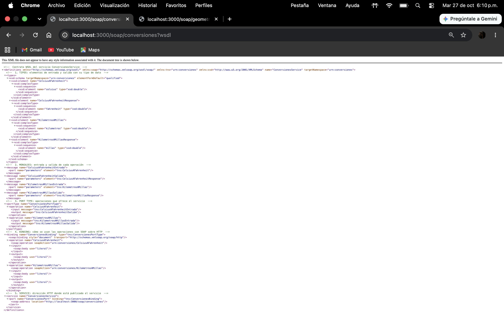
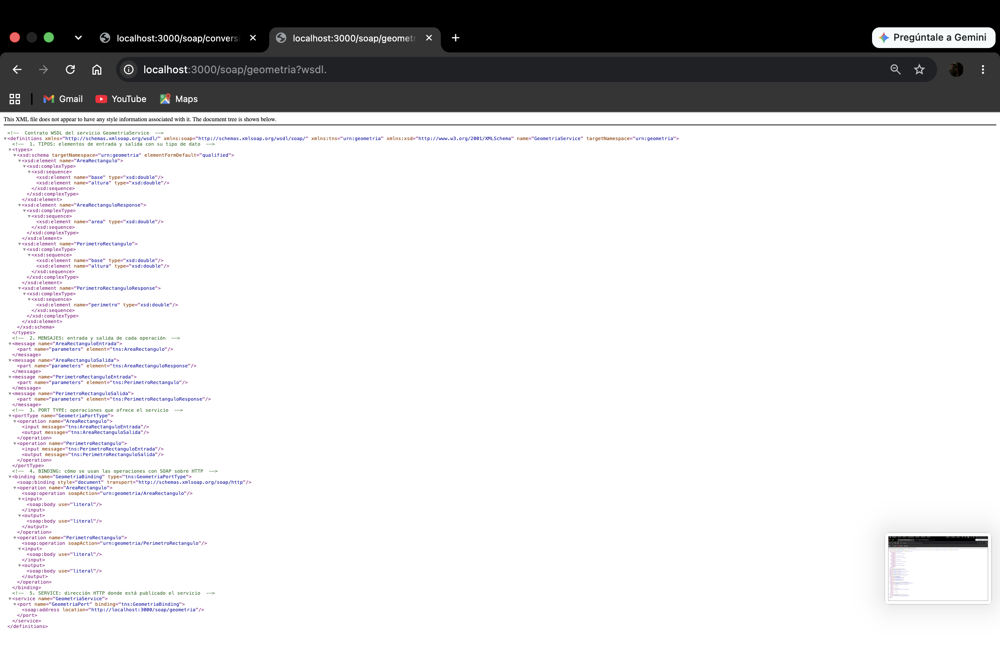
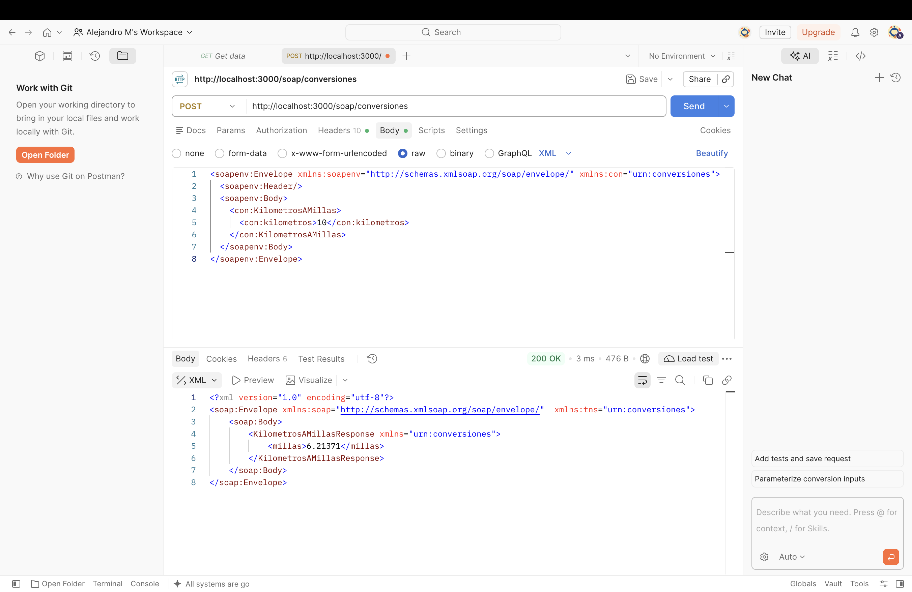
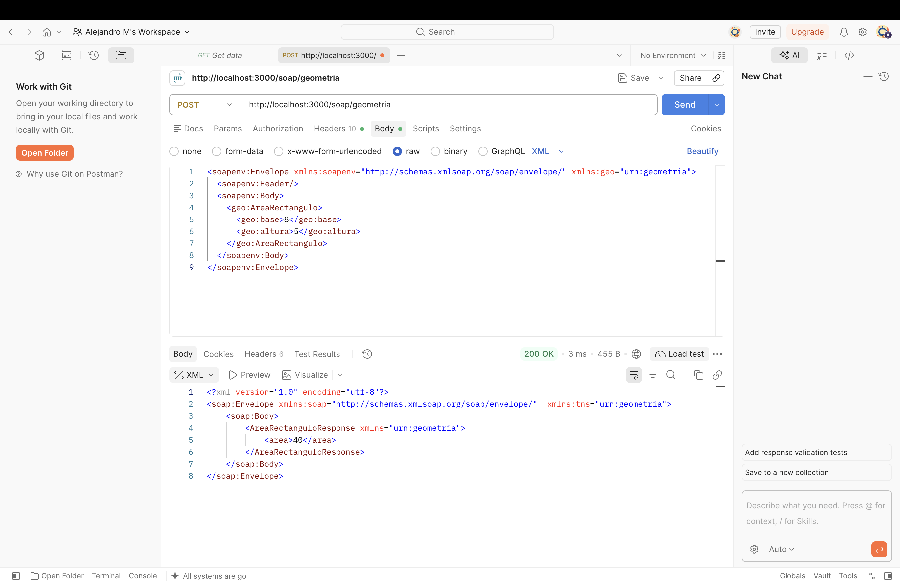
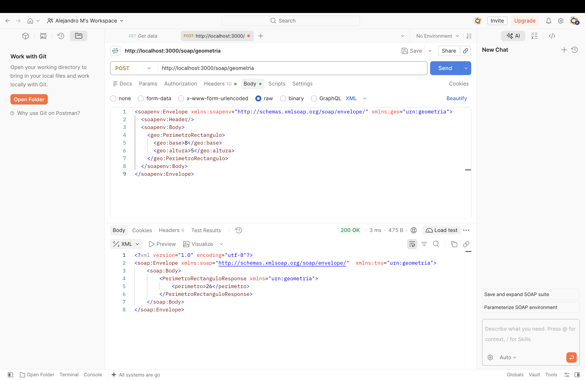
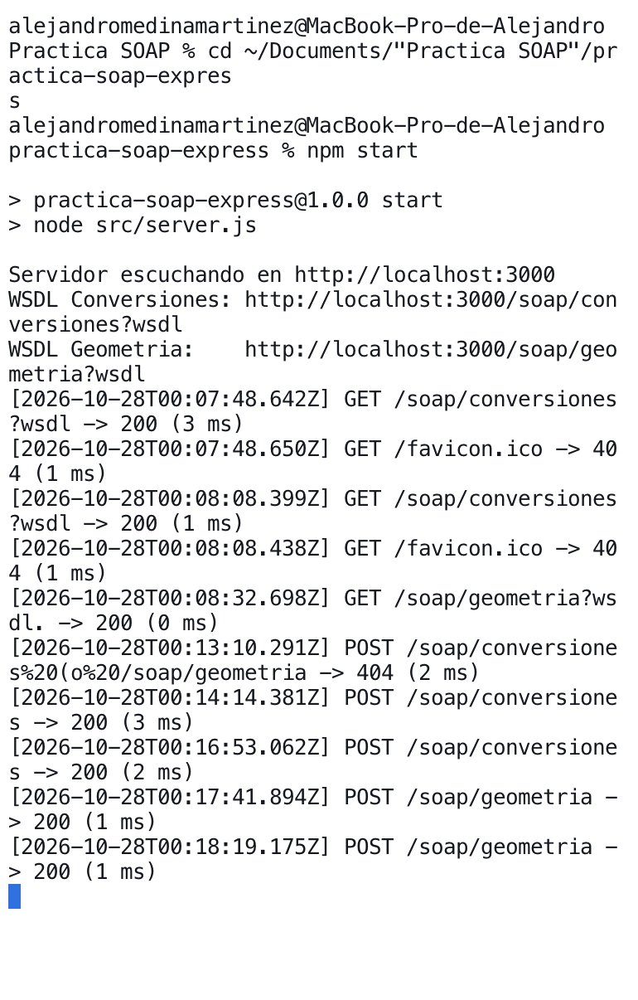

# Práctica: Servicios web SOAP con Express y WSDL

Aplicación en Node.js y Express que expone dos servicios web SOAP (`ConversionesService` y `GeometriaService`). Cada servicio tiene su propio contrato WSDL y dos operaciones. Las peticiones y respuestas se intercambian en XML dentro de un sobre SOAP.

## Requisitos

- Node.js 18 o superior
- npm
- curl, Postman o SoapUI para las pruebas

## Instalación

```bash
git clone <URL-de-este-repositorio>
cd practica-soap-express
npm install
```

## Ejecución

```bash
npm start
```

El servidor queda escuchando en `http://localhost:3000`.

> El puerto 3000 está escrito en `src/config.js` y también en la dirección (`soap:address`) de cada WSDL. Si se cambia, hay que cambiarlo en los tres archivos.

## Endpoints y contratos WSDL

| Servicio | Endpoint SOAP | Contrato WSDL | Operaciones |
|---|---|---|---|
| ConversionesService | `http://localhost:3000/soap/conversiones` | `http://localhost:3000/soap/conversiones?wsdl` | CelsiusAFahrenheit, KilometrosAMillas |
| GeometriaService | `http://localhost:3000/soap/geometria` | `http://localhost:3000/soap/geometria?wsdl` | AreaRectangulo, PerimetroRectangulo |

Los WSDL se pueden abrir directamente en el navegador.

## Estructura del proyecto

```
src/
  server.js                      Arranque del servidor (app.listen)
  app.js                         Configuración de Express: middleware + Router
  config.js                      Puerto de la aplicación
  middleware/logger.js           Middleware de registro de peticiones
  routes/soap.routes.js          Router que registra los dos servicios SOAP
  services/conversiones.service.js   Lógica de ConversionesService
  services/geometria.service.js      Lógica de GeometriaService
  wsdl/conversiones.wsdl         Contrato de ConversionesService
  wsdl/geometria.wsdl            Contrato de GeometriaService
pruebas/                         Peticiones SOAP (XML) de prueba
evidencias/                      Respuestas, WSDL y registro del middleware
CONCLUSIONES.md                  Conclusiones de la práctica
```

## Pruebas

Con el servidor encendido (`npm start`), abre otra terminal en la carpeta del proyecto.

### 1. Consultar los contratos

```bash
curl http://localhost:3000/soap/conversiones?wsdl
curl http://localhost:3000/soap/geometria?wsdl
```

### 2. Invocar las operaciones

Cada petición lleva el encabezado `Content-Type: text/xml` y el `SOAPAction` de la operación.

**CelsiusAFahrenheit** (25 °C → 77 °F)

```bash
curl -X POST http://localhost:3000/soap/conversiones -H "Content-Type: text/xml; charset=utf-8" -H "SOAPAction: \"urn:conversiones/CelsiusAFahrenheit\"" --data @pruebas/celsius-a-fahrenheit.xml
```

**KilometrosAMillas** (10 km → 6.21371 mi)

```bash
curl -X POST http://localhost:3000/soap/conversiones -H "Content-Type: text/xml; charset=utf-8" -H "SOAPAction: \"urn:conversiones/KilometrosAMillas\"" --data @pruebas/kilometros-a-millas.xml
```

**AreaRectangulo** (base 8, altura 5 → 40)

```bash
curl -X POST http://localhost:3000/soap/geometria -H "Content-Type: text/xml; charset=utf-8" -H "SOAPAction: \"urn:geometria/AreaRectangulo\"" --data @pruebas/area-rectangulo.xml
```

**PerimetroRectangulo** (base 8, altura 5 → 26)

```bash
curl -X POST http://localhost:3000/soap/geometria -H "Content-Type: text/xml; charset=utf-8" -H "SOAPAction: \"urn:geometria/PerimetroRectangulo\"" --data @pruebas/perimetro-rectangulo.xml
```

### Con Postman

1. Método `POST` y la URL del endpoint (por ejemplo `http://localhost:3000/soap/conversiones`).
2. En *Headers*: `Content-Type: text/xml; charset=utf-8` y `SOAPAction: urn:conversiones/CelsiusAFahrenheit`.
3. En *Body* → *raw* → *XML*: pega el contenido del archivo de `pruebas/` correspondiente.
4. Envía y revisa la respuesta SOAP.

### Resultados esperados

| Operación | Entrada | Resultado | Respuesta guardada |
|---|---|---|---|
| CelsiusAFahrenheit | 25 | `<fahrenheit>77</fahrenheit>` | `evidencias/respuesta-celsius-a-fahrenheit.xml` |
| KilometrosAMillas | 10 | `<millas>6.21371</millas>` | `evidencias/respuesta-kilometros-a-millas.xml` |
| AreaRectangulo | 8, 5 | `<area>40</area>` | `evidencias/respuesta-area-rectangulo.xml` |
| PerimetroRectangulo | 8, 5 | `<perimetro>26</perimetro>` | `evidencias/respuesta-perimetro-rectangulo.xml` |

Ejemplo de respuesta:

```xml
<soap:Envelope xmlns:soap="http://schemas.xmlsoap.org/soap/envelope/" xmlns:tns="urn:conversiones">
  <soap:Body>
    <CelsiusAFahrenheitResponse xmlns="urn:conversiones">
      <fahrenheit>77</fahrenheit>
    </CelsiusAFahrenheitResponse>
  </soap:Body>
</soap:Envelope>
```

## Middleware de registro

`src/middleware/logger.js` se ejecuta antes de las rutas SOAP. Para cada petición muestra en la consola el método, la URL, el código de estado y el tiempo de procesamiento:

```
[2026-10-27T23:58:43.391Z] GET /soap/conversiones?wsdl -> 200 (1 ms)
[2026-10-27T23:58:43.404Z] POST /soap/conversiones -> 200 (2 ms)
```

El registro completo de las pruebas está en `evidencias/registro-middleware.txt`.

## body-parser

En `src/app.js` se usa `bodyParser.raw()` para peticiones `text/xml` y `application/soap+xml`, como recomienda la documentación de [node-soap](https://github.com/vpulim/node-soap). Lee el cuerpo de la petición tal cual, sin convertirlo, y se lo entrega a node-soap para que procese el sobre XML.

Orden de los middleware en `app.js`:

1. `logger`: registra la petición.
2. `bodyParser.raw()`: lee el XML recibido.
3. `soapRoutes`: Router con los servicios SOAP.

## Evidencias

### Contratos WSDL

**ConversionesService**



**GeometriaService**



### Respuestas SOAP

**CelsiusAFahrenheit** (25 → 77)


**KilometrosAMillas** (10 → 6.21371)



**AreaRectangulo** (8, 5 → 40)



**PerimetroRectangulo** (8, 5 → 26)



### Registro del middleware


